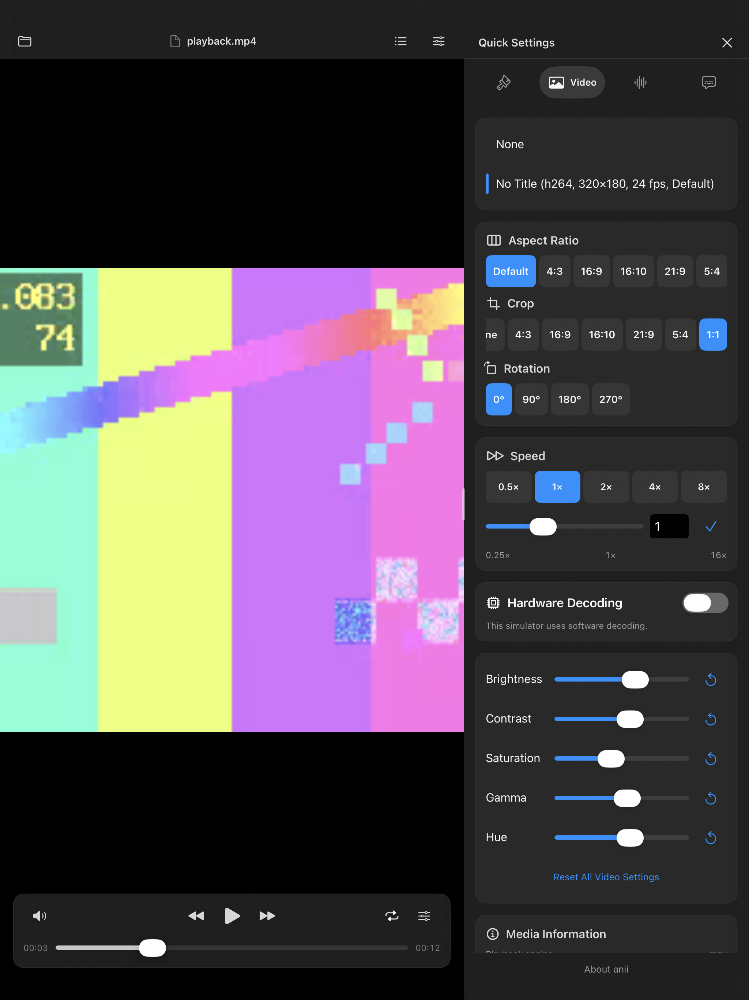
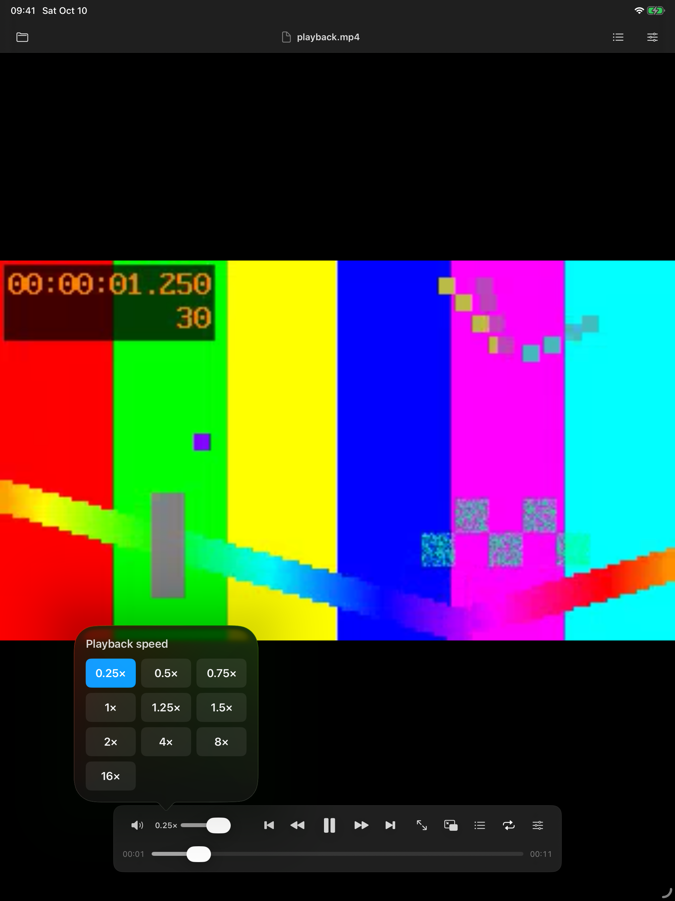
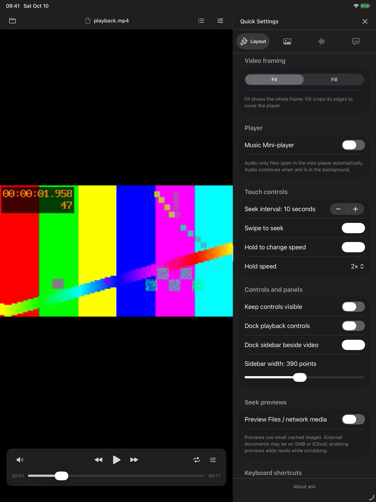
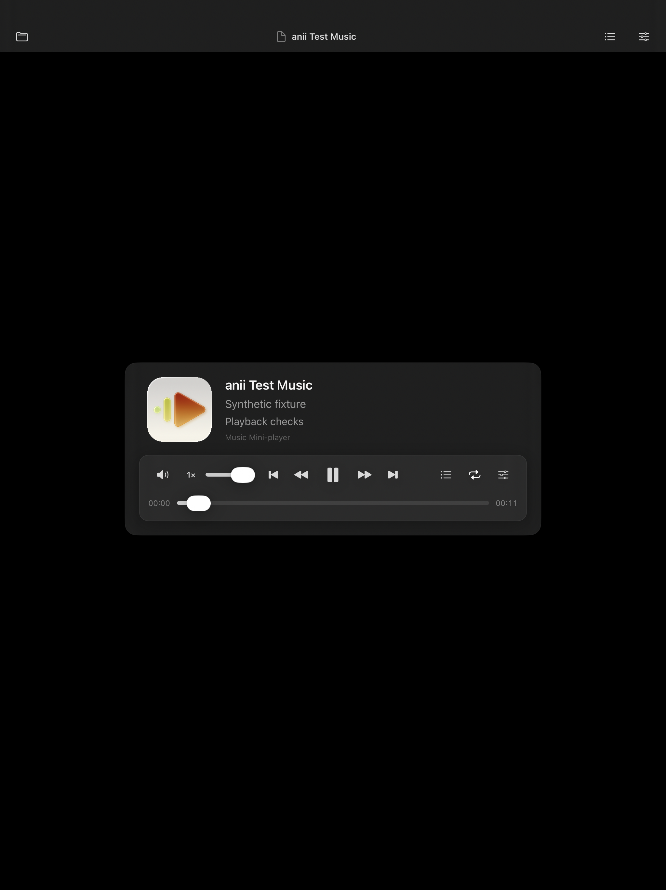
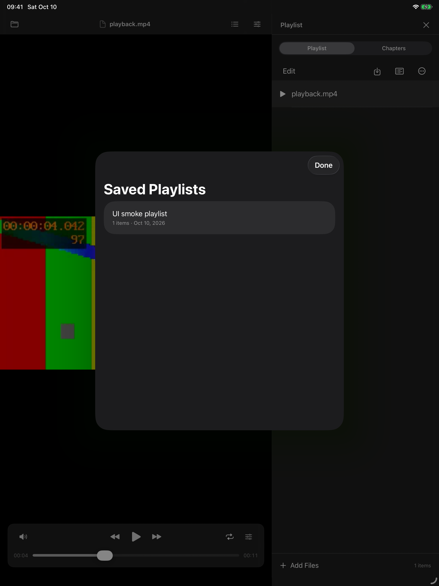
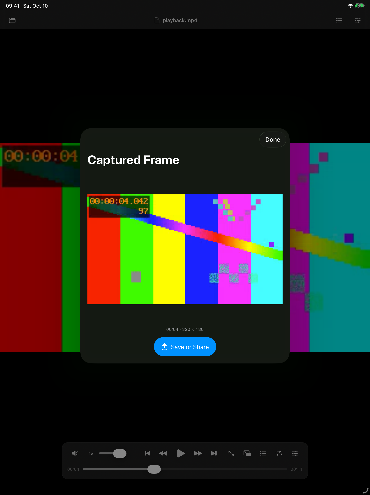

# anii


**An independent, experimental iPadOS media player inspired by IINA on macOS.** anii is unofficial and is not affiliated with, maintained by, or endorsed by the IINA project. This repository contains the iPad app only.

The interface uses SwiftUI/UIKit, tries Apple's AVPlayer first, and uses mpv when native playback cannot handle a format or a requested advanced feature. Development used OpenAI Codex assistance; this repository's maintainer is responsible for reviewing and maintaining the result.

Current version: **0.8.1, build 9**. Sources, build definitions, editable licensed artwork, and synthetic test assets are included. Compiled apps and downloaded playback-library bundles are excluded. The application is offered under **GPL-3.0-only**, without warranty; see [LICENSE](LICENSE) and [third-party notices](THIRD_PARTY_NOTICES.md).

## Install on your iPad

Start with the **[step-by-step installation guide](INSTALL.md)**. It explains downloading the project, connecting your iPad, selecting your own signing account, pressing Run, and renewing a free test build. **No coding, Terminal, or XcodeGen is required.**

You need a Mac, Xcode 26 or newer with support for your iPad's OS, and an iPad running iPadOS 17 or newer. No App Store, TestFlight, or IPA release is provided. Free Personal Team signing expires after seven days; the guide explains how to reinstall.

## Screenshots

Actual simulator snapshots using synthetic test media. Click for the full-size capture; [capture notes](Screenshots/README.md) explain the fixtures and simulator differences.

| Video settings | Playback speed | Touch controls and layout |
| --- | --- | --- |
| [](Screenshots/video-settings.png) | [](Screenshots/playback-speed.png) | [](Screenshots/controls-layout.png) |
| **Music mini-player** | **Saved playlists** | **Frame capture** |
| [](Screenshots/music-mini-player.png) | [](Screenshots/saved-playlists.png) | [](Screenshots/frame-capture.png) |

## Build

1. Open `anii.xcodeproj` with Xcode 26 or newer; the Icon Composer assets require that toolchain. Xcode 27 is used for the current local checks.
2. Resolve the pinned `mpvkit/MPVKit` **1.0.0** package at commit `288527dffbc6d3e63cce147fc7b520c64a791603`. The selected product is **MPVKit**, which upstream declares LGPLv3. `MPVKit-GPL` is a different product.
3. Select the `anii` scheme and an iPad simulator. The deployment target is iPadOS 17 or newer.
4. For a physical device, select your own signing team and an available bundle identifier in Xcode. No developer team, certificate, provisioning profile, or service credentials are supplied.

The generated Xcode project is checked in. To regenerate it after changing `project.yml`, install XcodeGen and run `xcodegen generate` in this directory. All build paths are relative to this project.

For example, with a matching simulator installed:

```sh
xcodebuild -project anii.xcodeproj -scheme anii \
  -destination 'platform=iOS Simulator,name=iPad Air 13-inch (M4)' \
  CODE_SIGNING_ALLOWED=NO build
```

Swift Package Manager downloads native dependencies from their suppliers. Its caches and artifacts are local build inputs and are excluded from this repository.

## Playback and controls

- AVPlayer is tried first for supported media; mpv supplies format compatibility and advanced subtitle/video controls. Media information shows the active engine and reason for a switch.
- Both engines provide inline playback and system Picture in Picture. Background audio, a music mini-player, and Now Playing/media controls are included.
- Files imports, selected-folder playback, URL opening, editable and saved playlists, natural filename sorting, shuffle, repeat one/all, A–B loops, and typed timestamp navigation are available.
- Speed controls include 0.5×, 2×, 4×, and 8×. A configurable hold gesture temporarily changes speed; horizontal swipes seek with visible feedback.
- Quick Settings provides track/encoding information, aspect ratio, crop, rotation, speed, timing, available decoder/buffering diagnostics, and supported video adjustments.
- Subtitles support embedded/external tracks, primary and secondary tracks, appearance/position/encoding controls, and OpenSubtitles search/download.
- Playback tools include cached seek thumbnails, supported frame stepping, clean frame capture/sharing, keyboard shortcuts, and docked/resizable panels.

## Bullet comments (弹幕)

While playing a video, tap the **speech-bubble button** in the top bar, or choose **Bullet Comments…** in the file menu. You can import Bilibili XML, Dandanplay JSON, or anii JSON from Files, enable individual sources, and adjust each source's delay. Positive delay displays comments later. Imported data and source settings are saved locally for that video; a changed cloud URL may require selecting its sources again.

The same native overlay works with AVPlayer and mpv. Comments pause with playback, follow seeking and speed changes, and reserve the lower part of the picture for subtitles. Dense comments are limited to available lanes. Identical comments at approximately the same timestamp are deduplicated across enabled sources. The overlay appears inside anii; it is not included in system Picture in Picture or clean frame captures.

For online matching, open **Provider Setup** and enter your own approved Dandanplay application ID and secret. Credentials are stored in the device Keychain. Tap **Find Matching Video** to send the entered title and playback duration, or use **Search Title Instead**, then confirm an episode before loading its comments. No video data, private folder path, or cloud URL is sent. Dandanplay's current response does not include candidate durations; the app does not invent a duration confidence score. Sources can require a timing adjustment when cuts differ.

**Include related platforms** loads the provider's aggregated feed. It remains labeled as an aggregated source because the API does not guarantee each comment's original platform. Sources imported separately can always be enabled or disabled independently. Loaded comments are retained locally; reselecting a recently loaded source uses the six-hour cache. **Refresh** explicitly requests a newer copy. There is no continuous socket connection, posting, or background polling in this implementation.

Local imports work without any account. iyf.tv integration is not enabled: its website endpoints have no verified third-party access agreement or stable documented API. See [Dandanplay's integration guide and usage requirements](https://doc.dandanplay.com/open/). No application credential is supplied with this project.

An anii JSON comment file has this structure (times and duration are seconds; mode is `scroll`, `top`, or `bottom`):

```json
{
  "title": "Example episode comments",
  "duration": 1440,
  "comments": [
    { "time": 12.5, "text": "A timed comment", "mode": "scroll", "color": "#FFFFFF" },
    { "time": 30, "text": "A fixed comment", "mode": "top", "color": "#FFD700" }
  ]
}
```

Imports are limited to 20 MB, eight sources per video, and 100,000 total comments. Malformed rows and unsupported XML modes are reported as skipped. XML external entities and scripted comments are not supported. Synthetic examples are in [Tests/Fixtures/bullet-comments.json](Tests/Fixtures/bullet-comments.json) and [Tests/Fixtures/bullet-comments.xml](Tests/Fixtures/bullet-comments.xml).

## Accounts and media

OpenSubtitles access requires the user's own registered API key, application User-Agent, and account. Credentials entered at runtime are stored in the device Keychain; login tokens stay in memory. Tests use an injected mock provider with obviously fictitious credentials. No provider key, downloaded subtitle collection, or user media is distributed.

The app does not host downloadable plugins or autoload mpv scripts/configuration, and does not supply DRM account or license handling. Users are responsible for authorization to access their media and provider services.

## Tests and current limits

`Tests` and `UITests` contain the maintained service, playback, playback-tools, and touch tests. [Fixture provenance](Tests/Fixtures/README.md) describes the synthetic media. Service tests use mock network responses; some playback/UI checks need a simulator or device and a local fixture server.

Bullet-comment validation on **2026-10-15** added **16 unit/integration checks and one UI check**, covering parsing/encodings, matching requests, credential-safe redirects, persistence, stale-request cancellation, source filters, timing, both playback engines, document opening, and panel controls. These checks passed, as did the existing 18 unit/integration and three UI checks in the regression run. The physical-iPad SDK build also succeeded without signing. Provider requests were tested against mock responses; live Dandanplay credentials and physical-device comment playback still need validation.

The standalone **anii 0.8.1** project built successfully with Xcode 27 and the pinned dependencies on 2026-10-10. The iOS 26.5 iPad simulator run passed **18/18 unit/integration tests** and **3/3 UI tests**, including both playback engines, speed switching, PiP, subtitle fallback, playlists, frame capture, and touch gestures. Tested application/build/fixture files were verified against this repository by checksum. Physical-device behavior has not been retested for the rename or the recent speed-switching fixes.

Extended file-provider/SMB reliability, high-bitrate playback, battery consumption, interruptions, real background transitions, HDR/Dolby Vision, and broader container/codec coverage still need validation. These experimental sources are not a general compatibility or performance certification.

The mpv inline sample-buffer renderer caps output at 1280×720; PiP caps it at 960×540, and output is 8-bit. AVPlayer has no application-imposed resolution cap. Native frame stepping depends on the item's reported capabilities. The earlier sparse-cue MKV seeking limitation is not claimed fixed.

Dedicated AirPlay routing, persistent playback history/resume, direct network-share browsing, desktop plugin hosting, and a full-resolution/HDR mpv renderer remain future work. Native-library binary-release compliance must also be completed before distributing an IPA or App Store build.

## Artwork and independence

The icon is a color-inverted adaptation of IINA's GPL-licensed Icon Composer artwork. SVG geometry and original project attribution are retained; the RGB color values have been inverted and static logo images rendered from the modified source. See [artwork provenance](THIRD_PARTY_NOTICES.md#iina-project-and-artwork).

The application code was independently authored for iPadOS. This is a standalone project with its own maintenance and support, rather than an official IINA target. Copyright licensing and attribution do not claim trademark rights or endorsement.

For help or contributions, use [this repository's issues](https://github.com/SleepAviator/anii/issues). Include the first relevant error, Xcode/iPadOS versions, and playback format; remove personal information and credentials from reports.
